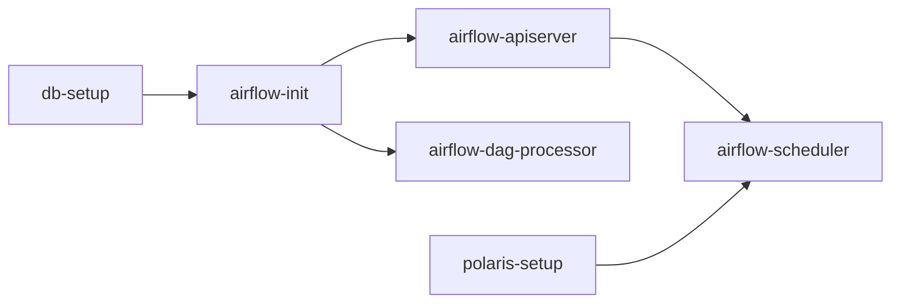
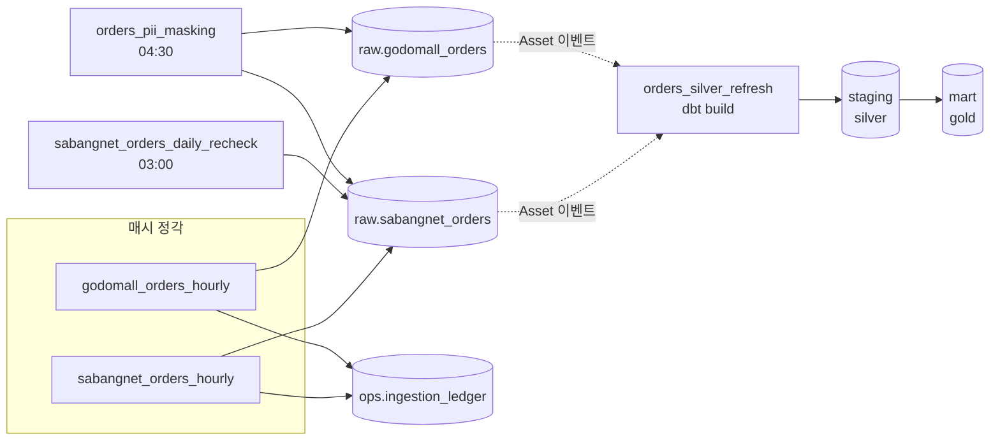
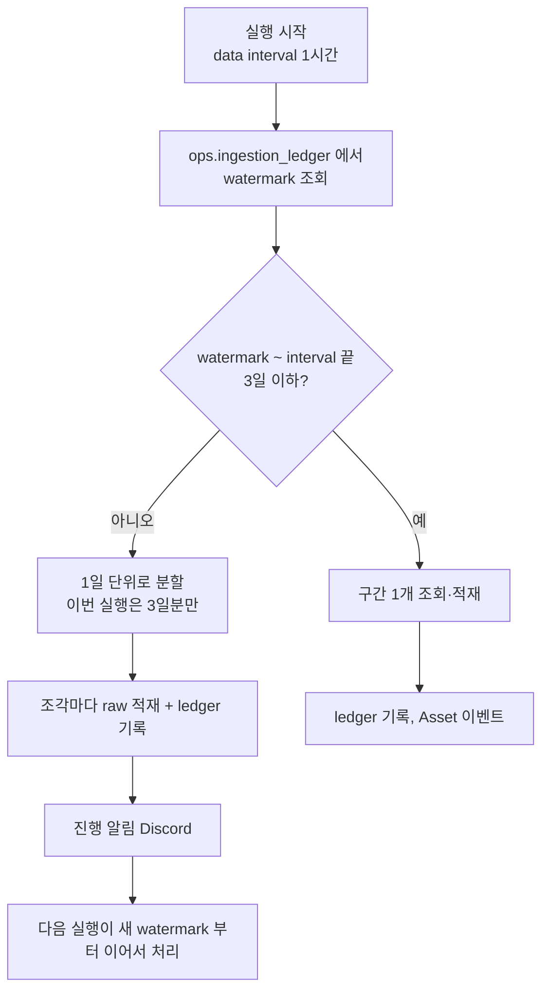

#### 들어가며

데이터 오케스트레이션의 핵심인 Apache Airflow는 작업 간 의존성 관리 및 일정 스케줄링을 담당한다. 본 데이터 플랫폼 구축 프로젝트에서 Airflow가 수행할 첫 번째 주요 미션은 **"매시간 주문 API 데이터를 수집하여 Iceberg `raw.orders` 테이블에 적재하는 파이프라인 구축"**이다. (1단계에서 채널별 `raw.sabangnet_orders`, `raw.godomall_orders` 로 분리. 현재 DAG 구성은 7절)

기본적인 설치 절차 대신, 본 아티클에서는 **Iceberg 저장층과의 효율적인 연동 방식**과 **제한된 로컬 컴퓨팅 리소스(MacBook Air) 환경에 맞춘 아키텍처 재설계 포인트**에 집중하여 기술한다.

---

#### 1. Airflow와 PyIceberg 연동 아키텍처

Airflow 파이프라인 코드 내부에서 데이터베이스 접속 정보나 인증 정보를 하드코딩하는 것은 안티패턴이다. 따라서 모든 Catalog 연결 설정은 **환경 변수 패턴**으로 추상화하여 주입했다.

```yaml
# docker-compose 환경 변수 설정 예시
PYICEBERG_CATALOG__LAKEHOUSE__TYPE: rest
PYICEBERG_CATALOG__LAKEHOUSE__URI: http://polaris:8181/api/catalog
PYICEBERG_CATALOG__LAKEHOUSE__WAREHOUSE: lakehouse
PYICEBERG_CATALOG__LAKEHOUSE__CREDENTIAL: airflow:******
PYICEBERG_CATALOG__LAKEHOUSE__SCOPE: PRINCIPAL_ROLE:ALL
PYICEBERG_CATALOG__LAKEHOUSE__S3__ENDPOINT: http://seaweedfs:8333
PYICEBERG_CATALOG__LAKEHOUSE__S3__ACCESS_KEY_ID: S3_KEY
PYICEBERG_CATALOG__LAKEHOUSE__S3__SECRET_ACCESS_KEY: S3_SECRET
```

PyIceberg 라이브러리는 다음과 같은 명명 규칙을 파싱하여 파이프라인에 자동으로 반영한다.
- `PYICEBERG_CATALOG__<CATALOG_NAME>__<PROPERTY>` 구문을 통해 해당 카탈로그 명칭의 인스턴스 옵션으로 변환
- 이중 언더스코어(`__`)는 점(`.`)으로, 단일 언더스코어(`_`)는 하이픈(`-`)으로 매핑 (예: `S3__ACCESS_KEY_ID` → `s3.access-key-id`)

결과적으로 DAG 파이프라인 코드상에서는 단 한 줄의 선언으로 카탈로그 연결을 안전하게 로드할 수 있다.

```python
from pyiceberg.catalog import load_catalog

catalog = load_catalog("lakehouse")
```

##### Trino와 Airflow의 카탈로그 설정 비교

| 구성 항목 | Trino Query Engine | Airflow Orchestrator (PyIceberg) |
| :--- | :--- | :--- |
| **설정 위치** | `catalog/iceberg.properties` | 환경 변수 (`PYICEBERG_CATALOG__...`) |
| **Polaris 계정** | `trino` (Principal) | `airflow` (Principal) |
| **객체 스토리지 접근** | 동일 S3 Key | 동일 S3 Key |
| **Target Catalog** | `lakehouse` | `lakehouse` |

두 분산 구성요소가 동일한 Polaris REST Catalog를 바라보므로, Airflow에서 적재 후 **트랜잭션이 커밋(Commit)되는 즉시** Trino에서 최신 스냅샷을 쿼리할 수 있다. Polaris의 메타데이터 포인터가 원자적으로 갱신되기 전까지는 쓰기 작업 중인 파티션이 읽기 작업에 노출되지 않아 데이터 일관성이 완벽히 보장된다.

---

#### 2. 컨테이너 토폴로지 및 리소스 제어

로컬 개발 환경의 메모리 제약을 극복하기 위해 다음과 같이 실행 컨테이너 흐름을 경량화했다.



| 서비스 컨테이너 | 담당 기능 | 메모리 Limit / 사용량 (2026-10-13 측정) |
| :--- | :--- | :--- |
| `airflow-init` | DB 마이그레이션 수행 (완료 후 정지) | Exited (0) |
| `airflow-apiserver` | Web UI 제공 및 상태 보고 엔드포인트 | 768 MiB / 293 MiB |
| `airflow-scheduler` | 스케줄링 및 **LocalExecutor 기반 작업 수행** | 1 GiB / 436 MiB → 현재 limit 1.5 GiB |
| `airflow-dag-processor` | `dags/` 디렉터리 파싱 및 DAG 메타데이터 갱신 | 384 MiB / 173 MiB |

> **LocalExecutor 배치 이유**: 독립적인 Worker 컨테이너(CeleryWorker 등)를 둘 필요 없이 Scheduler 내부 프로세스에서 작업을 즉시 실행함으로써 컨테이너 오버헤드를 대폭 절감했다.

- scheduler limit 1 GiB → 1.5 GiB (2026-10-29): task 가 이 컨테이너에서 실행되므로, PII 마스킹 DAG 의 고도몰 첫 실행(파생값 약 80만 행)이 task 하나에 약 710MB 사용

---

#### 3. 기존 클라우드 구성 대비 최적화 포인트

| 구분 | 이전 (Cloud/BigQuery 빌드) | 현재 (Local Iceberg 빌드) | 변경 사유 및 기술적 효과 |
| :--- | :--- | :--- | :--- |
| **Triggerer** | 활성화 | **제거** | 비동기 대기 작업 미사용에 따른 메모리 점유 최소화 |
| **Memory Limit** | Unset (무제한) | 컨테이너별 strict 지정 | 로컬 host OOM(Out of Memory) 방지 |
| **Web Worker** | 4개 프로세스 | 1개 프로세스 | 리소스 절감을 위한 설정 조정 |
| **DAG Auto-start** | 즉시 등록 및 실행 | **일시정지 상태로 신규 등록** (`dags_are_paused_at_creation=True`) | 코드 수정/저장 시 외부 API 예기치 않은 호출 방지 |
| **Log Storage** | 로컬 디렉터리 Mount | Named Volume 분리 | 민감 자격 증명 로그의 Git 레포지토리 유출 차단 |
| **Web Port** | `8080` | `8081` | Trino 코디네이터(`8080`)와의 포트 충돌 회피 |

---

#### 4. 이미지 커스텀 및 제약 조건 파이프라인

공식 Airflow 파이썬 이미지 기반으로 의존 라이브러리를 안전하게 설치했다.

```dockerfile
FROM apache/airflow:3.3.2-python3.12
RUN pip install --no-cache-dir pyiceberg[pyarrow]==0.12.0
```

- PyIceberg 0.12.0 버전을 적용하여 PyArrow 호환성을 유지했다.

현재 이미지 (2026-11-17)

```dockerfile
FROM apache/airflow:3.3.2-python3.12
COPY requirements.txt /tmp/requirements.txt
RUN pip install --no-cache-dir -r /tmp/requirements.txt \
      --constraint "https://raw.githubusercontent.com/apache/airflow/constraints-3.3.2/constraints-3.12.txt"

USER root
RUN python -m venv /opt/dbt-venv \
 && /opt/dbt-venv/bin/pip install --no-cache-dir dbt-core==1.12.6 dbt-trino==1.11.0 \
 && ln -s /opt/dbt-venv/bin/dbt /usr/local/bin/dbt
USER airflow
```

- 추가 패키지(`pyiceberg-core`, `trino` 클라이언트 등)는 `requirements.txt` 로 분리. Airflow 공식 constraints 파일로 기존 의존성 버전 고정
- dbt 는 전용 가상환경(`/opt/dbt-venv`)에 설치. Airflow 와 의존성 충돌 방지. DAG 에서는 `/usr/local/bin/dbt` 로 호출

---

#### 5. 보안 인증 정보 관리 체계

| 항목 | 역할 및 성격 | 변경 시 주의사항 |
| :--- | :--- | :--- |
| Admin Password | 웹 로그인 검증용 | 컨테이너 재시작 시 덮어쓰기 가능 |
| Fernet Key | DB 저장 데이터 암호화 키 | **변경 시 기존 데이터 복호화 불가** |

> **Warning**: Fernet Key는 데이터베이스 내 Connection, Variable 등 암호화된 필드를 해독하는 대칭키이다. 사전 조치 없이 변경 시 기존 접속 정보 파싱 과정에서 오류가 발생한다. 키 로테이션 수행 시 새 키와 구 키를 쉼표로 나열한 후 `airflow rotate-fernet-key` 명령을 실행해야 안전하다.

---

#### 6. 인프라 정상 작동 검증 (`_infra_smoke` DAG)

인프라 구성 완료 후 연동 상태 모니터링을 위해 Smoke Test DAG를 수행했다.

| 작업 단계 (Task) | 검증 요소 | 최종 결과 |
| :--- | :--- | :--- |
| `polaris_namespaces` | `load_catalog("lakehouse")` 호출 및 `raw` 네임스페이스 존재 여부 확인 | `['raw']` 수신 성공 |
| `seaweedfs_bucket` | PyArrow S3 파일시스템 인터페이스를 통한 `lake` 버킷 접근성 확인 | `['raw']` 버킷 엔트리 확인 |

---

#### 7. 현재 기준 DAG 구성 (2026-11-17)

0단계의 `_infra_smoke` 이후 1단계에서 수집·정제 DAG 7개 추가. 이름 규칙: `<출처>_<대상>_<주기>`. API 를 호출하는 DAG 는 출처(채널명)를 맨 앞에 표기.

| DAG | 일정 | 역할 |
| :--- | :--- | :--- |
| `sabangnet_orders_hourly` | 매시 정각 | 사방넷 주문 증분 수집 → `raw.sabangnet_orders` |
| `godomall_orders_hourly` | 매시 정각 | 고도몰 주문 증분 수집 → `raw.godomall_orders` |
| `sabangnet_orders_daily_recheck` | 매일 03:00 | 사방넷 주문일 기준 최근 7일 재조회. 시간별 수집이 놓치는 출고 전후 상태 변경 보정 |
| `orders_silver_refresh` | raw 적재 Asset 이벤트 | `dbt build` 로 silver·gold 갱신 |
| `orders_pii_masking` | 매일 04:30 | 주문일 60일 경과 raw 행 PII (개인식별정보) 부분 마스킹 |
| `sabangnet_orders_backfill`, `godomall_orders_backfill` | 수동 | 지정 기간 백필 |



##### 적재 직후 정제: Asset 트리거

- 수집 task 가 적재한 행이 있을 때 `outlets` 로 Asset 이벤트 발행 (`iceberg://lakehouse/raw/sabangnet_orders` 등)
- `orders_silver_refresh` 는 `schedule=(RAW_SABANGNET_ORDERS | RAW_GODOMALL_ORDERS)`. 두 채널 중 하나라도 적재되면 실행
- `max_active_runs=1`: 같은 시각 두 채널 이벤트가 겹쳐도 dbt 동시 실행 없음
- 실행 명령: `dbt build --exclude resource_type:seed`. seed(사람이 관리하는 기준 데이터)는 변경 시 수동 실행

##### 장기 중단 후 자동 따라잡기 (2026-11-09)

시간별 수집이 오래 멈춘 뒤 재개되면, 직전 적재 시점(watermark)부터 현재까지를 1일 단위로 나눠 실행 1회당 3일분씩 수집. 사람의 백필 없이 복구.



- 조각마다 ledger 를 기록하므로 중간 실패 시 완료한 조각은 재수집 없음
- 1일·3일 값: `pipelines/raw/window.py` 의 `CHUNK`, `RUN_BUDGET`. API 호출량과 task 메모리 상한 기준

---

#### 엔지니어링 요약 및 시사점

동일한 오케스트레이션 도구라도 운영 환경(클라우드 분산 환경 vs 단일 로컬 노드)에 따라 리소스 할당 전략 및 토폴로지가 완전히 달라져야 한다. 특히 외부 실환경 API와 연동되는 데이터 수집 파이프라인 개발 시 `dags_are_paused_at_creation=True` 설정 및 시크릿 파일 관리 기법을 적극 도입하여 안전성을 높였다.

#### 핵심 복습 질문
1. Airflow가 `raw.sabangnet_orders`에 데이터를 적재할 때 Trino에서 스냅샷이 실시간으로 검색되는 시점은 언제인가요?
2. Airflow Scheduler 컨테이너에 가장 많은 메모리를 배정한 기술적 배경은 무엇인가요?
3. Fernet Key 로테이션 시 안전하게 이전 키를 보존하고 갱신하는 3단계 절차는 무엇인가요?
