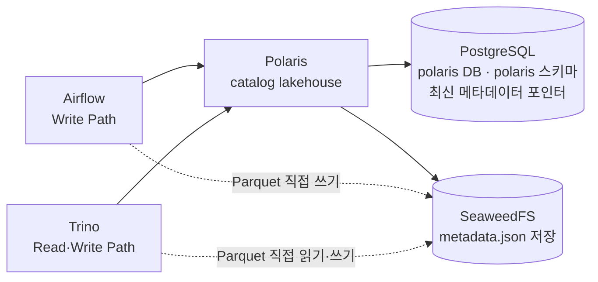
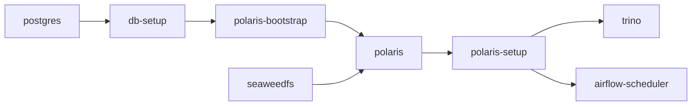
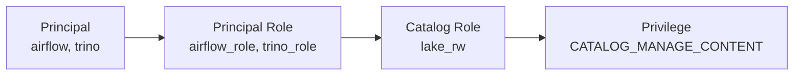
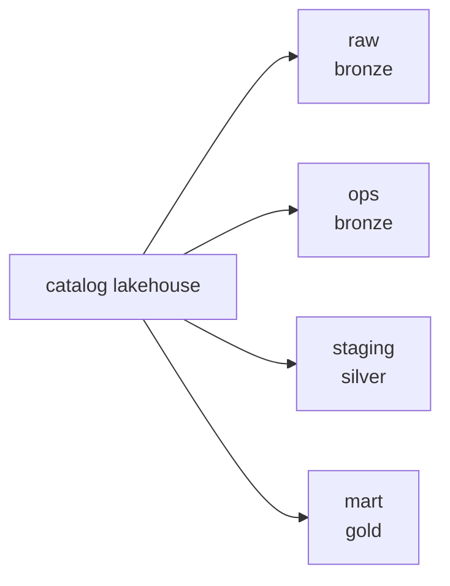

#### 개요

데이터 레이크하우스 아키텍처에서 카탈로그(Catalog)는 단순한 메타데이터 저장소가 아니다. Apache Polaris는 실제 데이터 바이트를 보유하지 않으며, **"Apache Iceberg 테이블의 최신 메타데이터 파일 포인터(`metadata.json`) 관리 및 트랜잭션 원자성 제공"**을 전담하는 오픈소스 REST Catalog 서비스이다.

본 문서에서는 독립된 REST Catalog가 필요한 이유와 Polaris 구축 과정에서 발생한 핵심 트러블슈팅 사례를 정리한다.

---

#### 1. 독립 REST Catalog 서비스가 필요한 기술적 이유

Iceberg 테이블은 분산 객체 스토리지에 저장되는 Parquet 데이터 파일과 Avro/JSON 메타데이터 파일의 집합이다. 데이터가 추가 및 변경될 때마다 새로운 메타데이터 파일(`metadata.json`)이 생성된다.

- **Write Path (Airflow)**: 데이터를 스토리지에 적재한 후, Polaris에 신규 `metadata.json`을 최신 포인터로 업데이트해 달라고 원자적 커밋을 요청한다.
- **Read Path (Trino)**: Polaris에 쿼리 대상 테이블의 최신 메타데이터 위치를 조회하여 해당 스냅샷 파일들을 직접 읽는다.



중앙 카탈로그 서비스가 없다면 개별 엔진이 스토리지의 파일 상태를 개별 추적해야 하므로 동시 쓰기(Concurrent Writes) 상황에서 Race Condition이 발생하고 메타데이터 유실이나 데이터 정합성 깨짐 현상이 초래된다.

##### ACID 트랜잭션 보장 원리

Trino나 Airflow가 `INSERT` 스냅샷을 생성할 때, Polaris는 하부 백엔드 데이터베이스(PostgreSQL)의 트랜잭션을 활용해 최신 포인터를 원자적으로 갱신한다.

1. Trino가 데이터 및 매니페스트 파일을 SeaweedFS에 업로드
2. Trino → Polaris: "최신 포인터를 `00001.metadata.json`에서 `00002.metadata.json`으로 교체해달라" 커밋 요청
3. Polaris가 DB 포인터 레코드를 원자적으로 스왑 (성공 시 반영 완료)

네트워크 오류나 프로세스 장애가 발생하더라도 Polaris의 최신 메타데이터 포인터는 갱신되지 않으므로, 쿼리 엔진에는 비정상적인 중간 데이터가 노출되지 않는다.

---

#### 2. 컨테이너 아키텍처 및 서비스 의존성

Polaris는 백엔드 RDBMS와의 스키마 마이그레이션 및 초기 부트스트랩 과정을 거쳐 가동된다.



| 서비스 | 담당 역할 | 가동 종료 상태 |
| :--- | :--- | :--- |
| `db-setup` | Polaris 전용 DB, 계정 및 스키마(`polaris`) 생성/보정 | Exited (0) |
| `polaris-bootstrap` | Polaris 내부 시스템 테이블 생성 및 관리자(root) 등록 | Exited (0) |
| `polaris` | Polaris REST Catalog 서버 본체 (Port 8181) | Up (healthy) |
| `polaris-setup` | Catalog, RBAC Role, Principal 및 Namespace 생성 (`raw`·`staging`·`ops`·`mart`) | Exited (0) |

---

#### 3. 주요 카탈로그 및 스토리지 접근 옵션

##### Polaris Persistence 설정
- `POLARIS_PERSISTENCE_TYPE=relational-jdbc`: 메타데이터 포인터 상태를 PostgreSQL에 영구 저장 (기본값인 In-Memory 모드는 컨테이너 재시작 시 메타데이터 유실)
- `POLARIS_DATABASE_JDBC_URL=.../polaris?currentSchema=polaris`: 스키마 격리 적용
- `polaris.readiness.ignore-severe-issues=true`: 개발 환경 구성을 위한 헬스체크 제약 완화

##### 카탈로그 Storage Config
```json
"storageConfigInfo": {
  "storageType": "S3",
  "allowedLocations": ["s3://lake/"],
  "endpoint": "http://seaweedfs:8333",
  "pathStyleAccess": true,
  "stsUnavailable": true
}
```
- `stsUnavailable: true`: SeaweedFS 환경 특성상 AWS STS(임시 자격 증명)를 지원하지 않으므로, 각 엔드포인트 도구가 자체 S3 Access Key를 직접 활용하도록 설정
- `pathStyleAccess: true`: 호스트네임 기반 버킷 주소 접근을 차단하고 경로 기반 주소(`http://seaweedfs:8333/lake`)로 고정

---

#### 4. 3-Tier RBAC 권한 모델

Polaris는 세 단계로 분리된 권한 제어 아키텍처를 제공한다.



- **Principal**: 접속 주체 자격 증명 (`airflow`, `trino`)
- **Principal Role**: 계정 그룹화 역할 (`airflow_role`, `trino_role`)
- **Catalog Role**: 특정 카탈로그 범위 내 행동 제어 권한 (`lake_rw`)

예를 들어 Trino 엔진의 권한을 읽기 전용으로 제한하려면 `lake_ro`라는 Catalog Role을 신규 생성한 후 `trino_role`에 바인딩하여 개별 계정 수정 없이 권한 정책을 변경할 수 있다.

---

#### 5. 주요 트러블슈팅 가이드

##### 사례 1: `no schema has been selected to create in` 오류
- **원인**: Polaris 부트스트랩 스크립트는 설정된 스키마에 포인터 테이블을 생성하려 시도하나, DB 스키마 자체를 자동 생성하지는 않음.
- **해결**: `db-setup` 컨테이너 단계에서 `CREATE SCHEMA IF NOT EXISTS polaris;` 문을 명시적으로 실행하고 JDBC URL 끝에 `?currentSchema=polaris` 옵션을 부여하여 해결.

##### 사례 2: Process Command Line을 통한 Root Credentials 로그 노출
- **원인**: `polaris-bootstrap` 실행 시 인증 인수를 직접 명령줄에 전달하여 컨테이너 시작 로그에 평문 자격 증명이 노출됨.
- **해결**: 자격 증명을 600 권한의 컨테이너 내 임시 파일로 작성한 후 `--credentials-file` 인자로 파일 경로를 전달하도록 변경하고, 노출된 Credential은 즉시 재발급 수행.

---

#### 6. 네임스페이스 구성

`polaris-setup`이 생성하는 네임스페이스는 다음과 같다. 이미 존재하는 경우 409 응답을 정상 처리하도록 구성하여 멱등성을 보장한다.



| 네임스페이스 | 단계 | 용도 |
| :--- | :--- | :--- |
| `raw` | 0단계 | API 응답 원본 적재 |
| `ops` | 1단계 수집 | 수집 구간 이력(`ingestion_ledger`) |
| `staging` | 1단계 실버 | dbt 채널별 정리 모델, 통합 뷰 |
| `mart` | 1단계 gold | 차원 `dim_*`, 사실 `fct_*`, 집계 `agg_*` |

- `airflow`, `trino` 두 Principal 모두 동일한 `lake_rw` 역할을 통해 전 네임스페이스에 접근한다.
- dbt는 별도 Principal 없이 Trino의 `trino` Principal을 통해 실행된다.

---

#### 회고 및 시사점

Polaris REST Catalog는 분산 컴퓨팅 엔진 간 메타데이터 동기화 및 ACID 트랜잭션 관리를 담당하는 핵심축이다. 오픈소스 도구 도입 시 공식 가이드의 기본값 변경 사항과 프로세스 실행 인자로 인한 민감 정보 노출 가능성을 철저히 점검해야 한다.