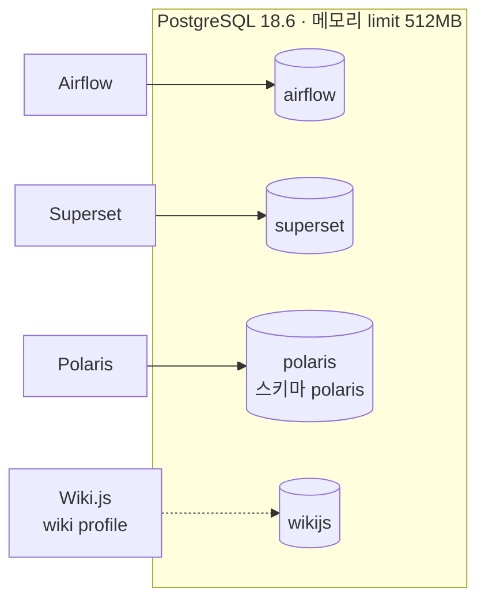
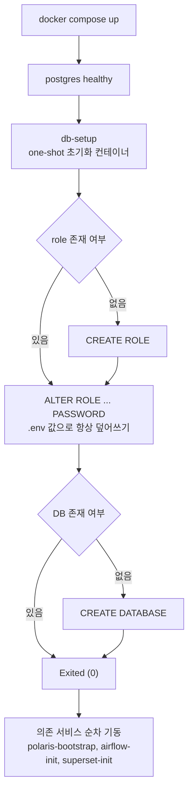

#### 개요

본 데이터 플랫폼의 RDBMS 계층에는 실제 비즈니스 주문 데이터가 저장되지 않는다. 대신 백엔드 메타데이터 스토어로 구축된 PostgreSQL이 **Airflow, Superset, Polaris의 실행 상태, 사용자 계정, 메타데이터 포인터 이력을 관리하는 영속성 레이어** 역할을 수행한다.

본 문서에서는 메타데이터 스토리지의 역할과 `.env` 설정 변경 시 컨테이너 환경에서 발생하는 자격 증명 불일치 문제를 해결하기 위한 **멱등적(Idempotent) DB 초기화 구조**를 정리한다.

---

#### 1. 메타데이터 스토리지의 역할과 장애 영향도

| 서비스 | 관리하는 메타데이터 항목 | 장애 발생 시 영향 |
| :--- | :--- | :--- |
| **Polaris** | Iceberg 테이블 최신 `metadata.json` 포인터 위치 | 테이블 스냅샷 조회 불가로 데이터 적재 및 쿼리 전체 중단 |
| **Airflow** | DAG 정의, Task 실행 상태, Variable/Connection 정보 | 파이프라인 스케줄링 및 작업 오케스트레이션 중단 |
| **Superset** | 대시보드/차트 쿼리 정의, 사용자 계정 및 권한 설정 | BI 대시보드 접근 및 시각화 쿼리 실행 불가 |
| **Wiki.js** | 위키 페이지, 폴더 구조, 사용자 계정 | 위키 열람 및 게시 불가 (원본 마크다운이 저장소 `wiki/`에 있어 재게시로 복구 가능) |

> **핵심 아키텍처 포인트**: 비즈니스 데이터(Parquet)는 객체 스토리지(SeaweedFS)에 보존되지만, 메타데이터 스토어인 PostgreSQL에 장애가 발생하면 테이블의 최신 스냅샷 포인터를 찾을 수 없으므로 **데이터 읽기(Read)와 쓰기(Write) 파이프라인이 모두 중단**된다.

---

#### 2. 멀티 테넌트 DB 구성 및 리소스 격리

단일 PostgreSQL 인스턴스 내부에 서비스별 전용 데이터베이스를 분리하여 구성했다. 초기 구축 시 3개(Airflow, Superset, Polaris)로 시작했으며, 이후 문서화를 위한 Wiki.js를 추가해 총 4개의 DB를 운영한다.



- **리소스 효율화**: 단일 RDBMS 인스턴스를 공유함으로써 호스트 메모리 점유량을 512MB 이내로 제한했다.
- **최소 권한 원칙(PoLP) 적용**: 서비스별 전용 사용자 계정(Role)을 분리하여, 특정 서비스의 자격 증명이 노출되더라도 타 서비스의 메타데이터 DB에 접근할 수 없도록 격리했다.
- **선택적 프로파일 분리**: `wikijs` DB는 `.env`에 `WIKIJS_DB_PASSWORD`가 정의된 경우에만 `db-setup`이 생성하며, Wiki.js 컨테이너 역시 `wiki` 프로파일로 분리해 필요시에만 기동한다.

---

#### 3. `.env` 변경 시 자격 증명 불일치와 멱등성(Idempotency) 확보

##### 기존 방식(`docker-entrypoint-initdb.d`)의 한계
PostgreSQL 공식 Docker 이미지의 `/docker-entrypoint-initdb.d/` 초기화 스크립트는 **데이터 볼륨이 최초 생성될 때 단 한 번만 실행**된다. 따라서 운영 중 `.env` 파일의 비밀번호를 변경하고 컨테이너를 재기동하더라도 DB 내부의 실제 계정 비밀번호는 초기값으로 고정되어 서비스 간 **인증 실패(Authentication Failed)**가 발생한다.

##### 해결 방식: 전용 초기화 컨테이너(`db-setup`) 도입
컨테이너 기동 시마다 `.env` 파일의 설정값을 읽어 백엔드 DB의 계정 및 데이터베이스 상태와 동기화하는 One-shot 초기화 컨테이너(`db-setup`)를 구성했다.



```sql
-- Dynamic SQL을 활용한 멱등적 Role 생성 및 비밀번호 동기화 스크립트
SELECT format('CREATE ROLE %I LOGIN', :'name')
 WHERE NOT EXISTS (SELECT 1 FROM pg_roles WHERE rolname = :'name')
\gexec

SELECT format('ALTER ROLE %I WITH LOGIN PASSWORD %L', :'name', :'pw')
\gexec
```

- `format('%I', ...)`와 `format('%L', ...)` 식별자/리터럴 포맷팅을 사용해 특수문자가 포함된 비밀번호 처리 시 발생할 수 있는 파싱 오류와 SQL 인젝션을 방지했다.
- 스크립트를 반복 실행하더라도 항상 `.env`에 정의된 목표 상태(Desired State)와 일치하도록 멱등성을 확보했다.

---

#### 4. 프로덕션 환경의 메타데이터 인증 관리 방식 비교

로컬 환경에서는 `.env`와 초기화 스크립트를 통해 상태를 동기화했지만, 클라우드 프로덕션 환경에서는 보안 및 운영 자동화를 위해 다음과 같은 아키텍처로 확장할 수 있다.

| 관리 방식 | 대표 도구 및 서비스 | 동작 메커니즘 및 특징 |
| :--- | :--- | :--- |
| **IAM 인증** | AWS RDS IAM / GCP Cloud SQL | 정적 패스워드를 제거하고 단기 OIDC/IAM 토큰을 발급받아 DB 접속 검증 |
| **상태 조정(Reconciliation)** | CloudNativePG / Terraform | 선언적 명세(Manifest)를 기준으로 실제 DB 상태를 지속 감시 및 동기화 (`db-setup`과 동일한 개념) |
| **중앙 시크릿 관리** | HashiCorp Vault / AWS Secrets Manager | 중앙 저장소에서 DB 패스워드를 주기적으로 자동 로테이션하고 애플리케이션에 동적 주입 |

---

#### 회고 및 시사점

컨테이너 기반 인프라에서는 **"설정 파일(`.env`)에 선언된 상태"**와 **"영속 볼륨에 저장된 실제 DB 상태"** 간의 불일치(Configuration Drift)가 빈번하게 발생한다. `.env`를 단일 진실 공급원(SSOT)으로 유지하기 위해, `db-setup`과 같이 기동 시점마다 상태를 보정하는 멱등적 초기화 단계를 파이프라인 의존성에 명시적으로 포함하는 것이 운영 안정성 측면에서 유효했다.