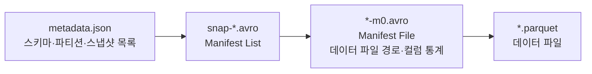
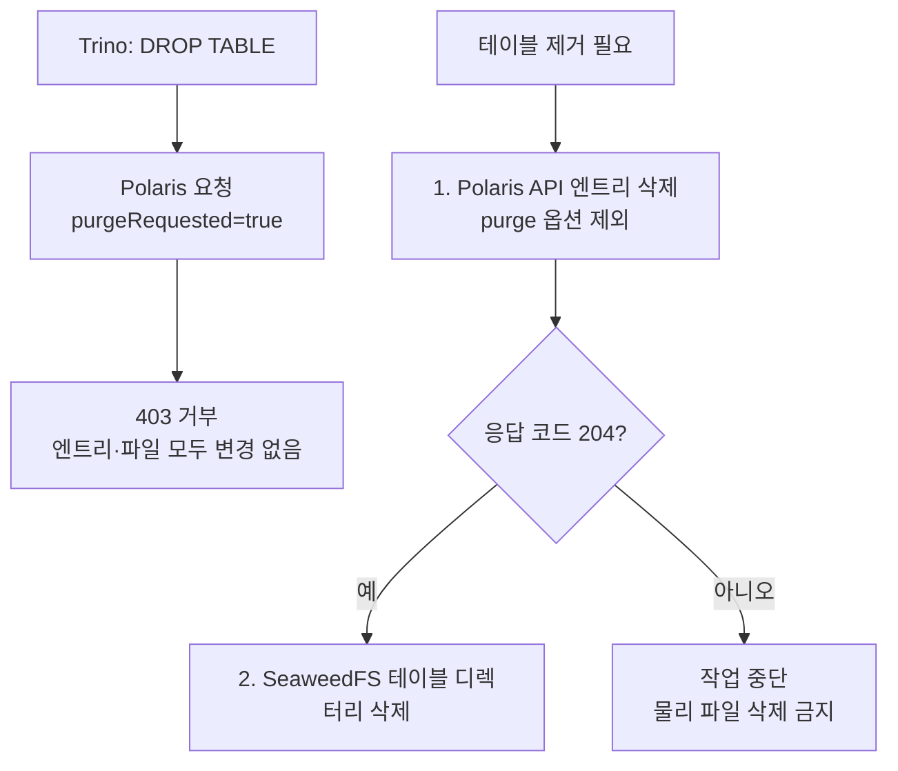
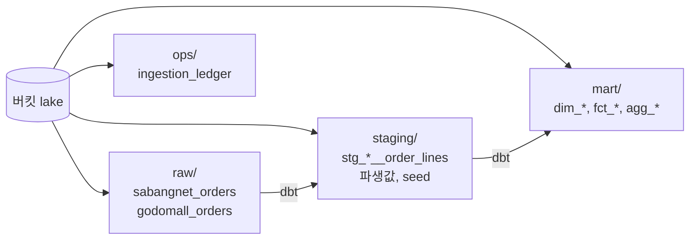

#### 개요

Apache Iceberg 테이블의 실체는 데이터베이스 내부 테이블이 아니라 분산 객체 스토리지상에 배치된 **규격화된 파일들의 집합**이다. 따라서 오케스트레이터(Airflow), 쿼리 엔진(Trino), 카탈로그(Polaris)가 공통으로 접근할 수 있는 표준 S3 호환 객체 스토리지가 필요하다.

본 문서에서는 오픈소스 객체 스토리지 선정 과정에서 검토한 기술적 기준과 SeaweedFS에 실제 적재되는 Iceberg 파일의 물리적 레이아웃 및 삭제 정책을 정리한다.

---

#### 1. 오픈소스 S3 스토리지 선정 배경 (MinIO vs SeaweedFS)

기존에 보편적으로 사용되던 MinIO는 오픈소스 배포 방식과 레포지토리 정책 변동 이슈가 발생함에 따라 대체 솔루션을 비교 검토했다.

| 후보 솔루션 | 장점 | 단점 및 제약사항 |
| :--- | :--- | :--- |
| **RustFS** | Rust 기반의 높은 처리 성능, MinIO 호환 Web UI 제공 | 정식 1.0 출시 기간이 짧아 프로덕션 검증 레퍼런스 부족 |
| **SeaweedFS** | **10년 이상 검증된 운영 안정성, 고성능 Haystack/Filer 아키텍처** | Master, Volume, Filer 등 멀티 컴포넌트 구조 |
| **Garage** | 경량 아키텍처 및 분산 환경 최적화 | 기본 관리 Web UI 부재, 수동 테넌트 구성 필요 |

데이터 레이크의 최하단 스토리지는 무엇보다 **운영 안정성이 입증된 기술 스택**이어야 하므로, 대규모 환경에서 장기간 검증된 **SeaweedFS**를 최종 선정했다.

---

#### 2. SeaweedFS 컨테이너 구성

로컬 개발 환경의 리소스 제약을 고려해 단일 프로세스로 동작하는 `mini` 모드로 구성했다.

```yaml
seaweedfs:
  image: chrislusf/seaweedfs:4.48
  command:
    - mini                       # 개발 및 단일 노드용 통합 프로세스 모드
    - -dir=/data
    - -bucket=${LAKE_BUCKET}     # 컨테이너 시작 시 자동 버킷 생성
    - -s3.port.iceberg=0         # 내장 Iceberg 카탈로그 비활성화 (Polaris로 일원화)
```

| 포트 번호 | 용도 및 서비스 |
| :--- | :--- |
| **`8333`** | S3 API 엔드포인트 (Airflow, Trino, Polaris 연동용) |
| **`8888`** | SeaweedFS Filer Web UI (스토리지 내부 디렉터리 브라우징) |
| **`23646`** | Master 관리 인터페이스 |

---

#### 3. Apache Iceberg 물리 파일 레이아웃 분석

Trino를 통해 테스트 테이블을 생성하고 2회의 `INSERT` 스냅샷을 발생시킨 뒤, SeaweedFS Filer 브라우저(`/buckets/lake/raw/`)에서 확인한 실제 디렉터리 구조는 다음과 같다.

```text
smoke_test-8e7e0204.../
├── data/
│   ├── ...073841....parquet          316 B   ← INSERT 1 (2 records)
│   └── ...073851....parquet          311 B   ← INSERT 2 (1 record)
└── metadata/
    ├── 00000-....metadata.json     1,662 B   ← CREATE TABLE 시점 메타데이터
    ├── 00001-....metadata.json     3,282 B   ← INSERT 1 후 메타데이터 (Snapshot 1)
    ├── 00002-....metadata.json     4,904 B   ← INSERT 2 후 메타데이터 (Snapshot 2 - Current)
    ├── snap-....avro ×3                       ← Snapshot Manifest List 파일
    ├── ....-m0.avro ×2                        ← Manifest File (데이터 파일 경로 및 통계)
    └── ....stats ×2                           ← Column Statistics
```

##### 물리적 레이아웃의 주요 특징
1. **불변성(Immutability)**: 한 번 생성된 Parquet 데이터 파일이나 메타데이터 JSON 파일은 제자리 수정(In-place Update)되지 않으며, 데이터 변경이 발생할 때마다 신규 파일이 생성된다.
2. **메타데이터 누적 구조**: `metadata.json` 파일 크기는 `1,662 B` → `3,282 B` → `4,904 B`로 점진적으로 증가한다. 최신 메타데이터 파일이 이전 스냅샷 이력 전체를 계층적으로 포함하기 때문이다.
3. **UUID 디렉터리 격리**: 테이블명 뒤에 부여되는 Hash UUID(`-8e7e...`)는 동일한 이름의 테이블을 삭제 후 재생성하더라도 기존 물리 데이터 파일과 경로가 충돌하지 않도록 격리한다.

파일 간 참조는 상위에서 하위로 이어지는 단방향 구조를 가진다. 상위 메타데이터 파일이 하위 파일의 경로를 기록하며, 하위 파일은 상위 파일을 참조하지 않는다.



---

#### 4. `DROP TABLE` 동작과 Purge 정책 (아키텍처 결정 0009)

> **정정 기록 (2026-10-14)**: 초기 문서에는 "`DROP TABLE` 실행 시 카탈로그 포인터만 삭제되고 물리 파일은 보존된다"고 기록했으나, 실제 동작 확인 결과 **DROP 명령 자체가 거부**되어 엔트리와 파일 모두 삭제되지 않은 것이었다.
{: .prompt-danger }

Trino에서 `DROP TABLE`을 실행하면 Polaris에 카탈로그 엔트리 삭제와 **물리 파일 삭제(Purge)를 함께 요청**한다(`purgeRequested=true`). Polaris는 기본 설정상 Purge를 허용하지 않으므로(`DROP_WITH_PURGE_ENABLED=false`) **요청 전체를 403 에러로 거부**하며, 카탈로그 엔트리조차 삭제되지 않는다.

```text
DELETE /api/catalog/v1/lakehouse/namespaces/raw/tables/smoke_test?purgeRequested=true → 403
Unable to purge entity ... set DROP_WITH_PURGE_ENABLED ...
```



본 프로젝트에서는 안전장치를 확보하기 위해 이 기본값을 **의도적으로 유지**한다.

- **Raw 레이어 보호**: Trino에서 실수로 `DROP TABLE iceberg.raw.sabangnet_orders`를 실행하더라도 아무런 변경이 일어나지 않는다. "원본(raw) 레이어 데이터는 삭제하지 않는다"는 운영 원칙을 작업자의 주의가 아닌 **시스템 설정**으로 강제했다.
- **수동 테이블 제거 절차**: 테스트 테이블이나 폐기 대상 테이블을 제거할 때는 반드시 다음 순서를 따른다.
  1. Polaris REST API로 Purge 옵션 없이 카탈로그 엔트리만 삭제 (`DELETE .../tables/<테이블명>` → `204` 확인)
  2. **1번 단계가 성공한 경우에만** SeaweedFS에서 해당 테이블 디렉터리 삭제
- **순서 준수의 중요성**: 1번(카탈로그 삭제)이 실패한 상태에서 2번(파일 삭제)을 먼저 실행하면 "카탈로그에는 존재하나 물리 파일은 없는" 손상된 테이블(Dangling Metadata)이 발생한다. 초기 상태 검증 스크립트(`check.sh`) 작성 과정에서 실제로 겪은 장애 유형이다.
- **트레이드오프 및 스크립트화**: 1번만 수행하고 2번을 생략하면 카탈로그가 참조하지 않는 고아 파일(Orphan Files)이 스토리지에 누적된다. 이를 방지하기 위해 1 → 2 순서를 강제하고 1번 실패 시 즉시 종료하는 `infra/tools/drop_table.sh <namespace> <table>` 스크립트를 구현해 테스트 및 폐기 대상 Gold 테이블 정리에 활용하고 있다(Raw 운영 테이블에는 실행 금지).

---

#### 5. 버킷 및 네임스페이스 디렉터리 구조

초기 구축 시에는 `raw` 네임스페이스 단일 구조였으나, 데이터 모델링 단계(1단계)를 거치며 레이어별 4개 네임스페이스로 확장했다. 각 네임스페이스는 `lake` 버킷 하위의 최상위 디렉터리와 1:1로 매핑된다.



| 네임스페이스 | 레이어 | 적재 주체 | 비고 |
| :--- | :--- | :--- | :--- |
| `raw` | Bronze | Airflow (PyIceberg) | API 응답 원본 적재(Append-only). 개인식별정보(PII) 60일 경과 마스킹 처리만 예외 적용 |
| `ops` | Bronze | Airflow (PyIceberg) | 수집 구간 이력 관리. 다음 배치 수집의 커서(Cursor) 기준 |
| `staging` | Silver | dbt (Trino) | 채널별 정제 모델(Incremental) 및 통합 뷰(`int_*`) |
| `mart` | Gold | dbt (Trino) | 차원·사실·집계 테이블. BI 대시보드 참조 대상 |

- 통합 뷰(`int_*`)는 Polaris 카탈로그에 논리적 정의만 저장되므로 SeaweedFS 내 물리 데이터 파일이 생성되지 않는다.
- dbt 모델 재생성(`on_table_exists: replace`) 시 남는 이전 스냅샷 파일은 향후 Iceberg 스냅샷 만료(Expire Snapshots) 배치 작업을 통해 정리할 예정이다.

---

#### 회고 및 시사점

Iceberg 기반 레이크하우스 아키텍처를 안정적으로 운영하려면, 데이터 파일의 불변성과 메타데이터 포인터 스왑 메커니즘을 물리 파일 레벨에서 이해해야 한다. 특히 객체 스토리지 선정 시에는 최신 기능보다 표준 S3 호환성과 운영 안정성을 최우선 기준으로 삼아야 하며, 데이터 유실 방지를 위해 카탈로그의 Purge 정책과 물리 파일 삭제 절차를 명확히 분리해 통제하는 것이 효과적이었다.