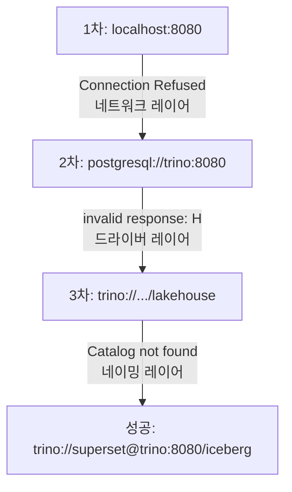
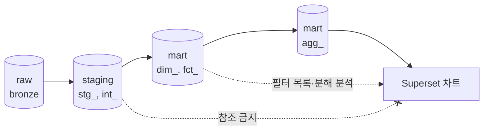
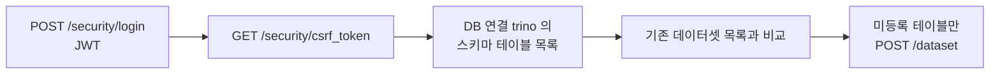

#### 개요

데이터 레이크하우스 구축의 최종 기준은 **"주문 데이터 수집 직후 분석가용 대시보드 표와 차트 수치가 지연 없이 갱신되는 것"**이다. 이를 위해 Trino 분산 엔진에 SQL 질의를 전달하여 결과를 시각화하는 BI 솔루션으로 Apache Superset을 도입했다.

Superset은 자체 데이터 저장을 수행하지 않고 쿼리 타임마다 Trino로 SQL을 푸시다운(Pushdown)하여 시각화를 수행한다. 본 문서에서는 Superset과 Trino 연동 과정에서 발생한 대표적인 네트워크 및 드라이버 연동 이슈와 해결 방안을 정리한다.

---

#### 1. 대시보드 질의 흐름 및 엔드투엔드 파이프라인

```mermaid
sequenceDiagram
    participant U as 브라우저
    participant SS as Superset
    participant T as Trino
    participant P as Polaris
    participant PG as PostgreSQL
    participant S as SeaweedFS
    U->>SS: 대시보드 열기
    SS->>T: SQL
    T->>P: 최신 메타데이터 포인터?
    P->>PG: 포인터 조회
    PG-->>P: 00002.metadata.json
    P-->>T: 메타데이터 위치
    T->>S: metadata·manifest·Parquet 읽기
    T-->>SS: 결과 행
    SS-->>U: 차트 렌더링
```



- **Superset의 연동 대상은 오직 Trino뿐이다.** 하부의 Polaris 카탈로그나 SeaweedFS 객체 스토리지는 직접 참조하지 않는다.
- Superset 내부 DB(PostgreSQL)에는 차트 구조, 대시보드 레이아웃, 사용자 권한 메타데이터만 저장된다.

---

#### 2. 컨테이너 드라이버 패키징 및 시크릿 옵션

공식 `apache/superset:6.1.0` Lean 이미지에는 PostgreSQL 저장소용 및 Trino 연동용 Python 드라이버가 포함되어 있지 않으므로, 커스텀 Dockerfile을 통해 종속성을 설치해야 한다.

```dockerfile
FROM apache/superset:6.1.0
USER root
RUN uv pip install --no-cache --python /app/.venv/bin/python \
      psycopg2-binary==2.9.9 \
      trino==0.340.0
USER superset
```

##### 주요 환경 변수 설정
- `SUPERSET_SECRET_KEY`: 대시보드에 등록된 암호화 데이터베이스 커넥션 자격 증명을 보호하는 대칭키이다. 이 키가 변경되면 등록된 모든 Database Connection 정보 파싱이 실패하므로 절대 임의로 변경해서는 안 된다.

---

#### 3. Trino 데이터베이스 연결 시 3대 트러블슈팅 사례

Trino 연결 커넥션 URI 형식: `trino://<USERNAME>@<HOST>:<PORT>/<CATALOG>`



##### 이슈 1: `localhost:8080` 지정 시 접속 거부 (`Connection Refused`)
- **원인**: Superset 컨테이너 내부에서 `localhost` 호출 시 호스트가 아닌 Superset 컨테이너 자신을 가리킴.
- **해결**: Docker Compose 내부 브리지 네트워크상의 서비스 도메인명인 `trino:8080`으로 엔드포인트를 변경하여 컨테이너 간 통신 수립.

##### 이슈 2: `postgresql://` 지정 시 SSL negotiate 에러 발생 (`received invalid response: H`)
- **원인**: Connection String 식별자 오류로 인해 Superset이 PostgreSQL 드라이버(`psycopg2`)로 Trino HTTP 포트에 접근을 시도함. Trino가 반환한 HTTP 헤더 첫 글자(`H`ttp/1.1)를 DB 패킷으로 오해하여 발생.
- **해결**: 데이터베이스 프로토콜 타입을 Trino로 정확히 지정(`trino://`).

##### 이슈 3: 카탈로그 지정 오류 (`Catalog 'lakehouse' not found`)
- **원인**: Polaris 내부 카탈로그 명칭인 `lakehouse`를 URI에 기재했으나, Trino 엔진 관점에서의 카탈로그 명칭은 커넥터 설정 파일명인 `iceberg` (`catalog/iceberg.properties`)임.
- **해결**: URI 상의 카탈로그 명칭을 `iceberg`로 변경하여 `trino://superset@trino:8080/iceberg`로 정상 연결.

---

#### 4. 현재 기준 구성 (2026-11-17)

##### 대시보드 데이터 경로
1단계에서 골드 레이어(`mart` 네임스페이스)가 구축되었으며, 대시보드 차트는 사전 집계 테이블 `mart.agg_*`만 참조한다. 실버 통합 뷰(`staging.int_*`)는 조회마다 전량 재계산(쿼리당 2~3초, 26~37MB 스캔)이 발생하므로 대시보드 직접 참조를 금지한다.



- **갱신 주기에 따른 반영**: 매시 수집 직후 `orders_silver_refresh` DAG가 dbt를 통해 골드 레이어를 재생성하며, 정각 후 수 분 이내 대시보드에 반영됨.
- **접근 경로**: Nginx 단일 진입점인 `http://superset.localhost` 사용.

##### 데이터셋 일괄 등록
Superset 웹 UI의 데이터셋 추가는 단건 처리만 지원하므로, 골드 테이블 11개를 REST API로 일괄 등록하는 스크립트(`infra/tools/superset_register_datasets.py`)를 작성하여 활용한다.



- 기등록 테이블은 자동 건너뛰어 멱등성을 보장하며, 골드 테이블 추가 시 재실행 가능.
- `--dry-run` 옵션을 통해 등록 대상 미리 확인 가능.

##### 한국어 현지화 설정
- 공식 이미지(4.1 이후)에는 번역 원본(`messages.po`)만 포함되어 있어 화면에 한국어가 즉시 표시되지 않음.
- 이미지 빌드 시 `build_translations.py`를 통해 서버용 `messages.mo` 및 화면용 `messages.json`을 생성하고, `superset_config.py`에 `BABEL_DEFAULT_LOCALE = "ko"` 지정.
- 번역률은 약 35% 수준이며 미번역 문구는 영문으로 표시됨. (예: 필터 패널 톱니바퀴 메뉴 내 "Add or edit filters and controls"가 "테이블 추가"로 오기재된 경우 존재)
- 이미지 빌드 정의는 `superset-init` 서비스에 포함되어 있음. `docker compose build superset` 단독 실행 시 반영되지 않으므로 `build superset-init` 수행 필요.

##### 대시보드 필터 (Native Filter)
- 위치: 대시보드 보기 모드 좌측 필터 패널 (편집 모드에서는 미표시). Superset 6 버전부터 추가 버튼이 패널 톱니바퀴 메뉴 내부로 이동함.
- 기간 지정 시 필터 타입으로 `Time range`를 사용해야 하며, `Value`에 날짜 컬럼을 직접 지정하면 개별 날짜 값 목록 선택으로 동작하여 기간 지정이 불가능해짐.
- `Time range`는 특정 컬럼을 명시하지 않으며 각 차트의 X축 시간 컬럼에 자동 적용됨.

---

#### 회고 및 시사점

분산 인프라 간 연동 시 발생하는 에러 메시지(네트워크, 드라이버 프로토콜, 엔티티 네이밍)를 단계별로 디버깅하는 역량이 필수적이다. 또한 컨테이너 내부의 `localhost`와 외부 네트워크 포트 간의 바인딩 차이를 명확히 인지하고 아키텍처를 설계해야 한다.