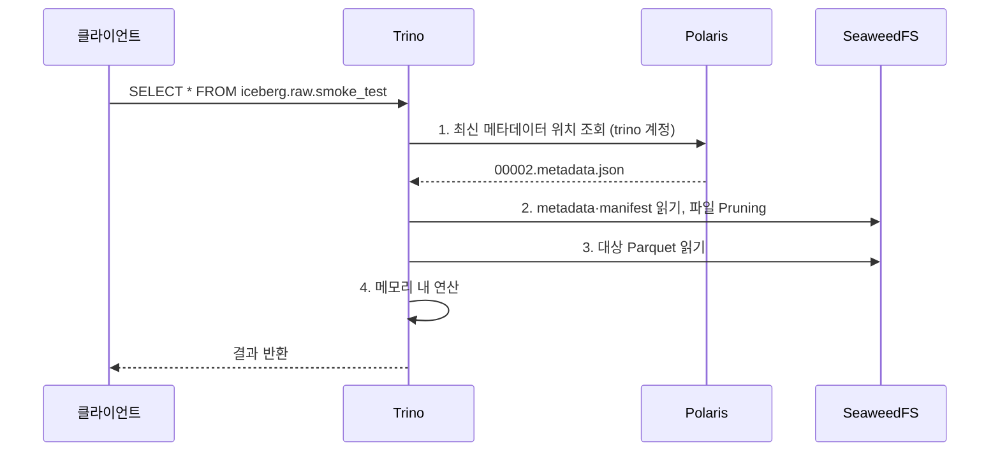
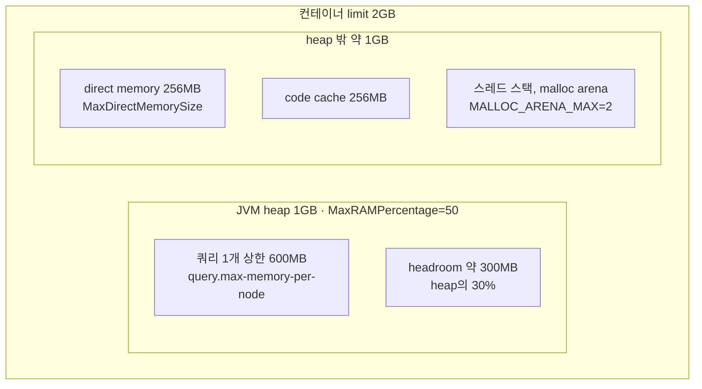
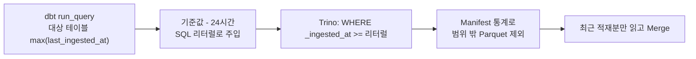

#### 들어가며

데이터 레이크하우스 구조에서 객체 스토리지(SeaweedFS)는 물리 파일을 보관하고 REST Catalog(Polaris)는 메타데이터 포인터 위치를 관리한다. 그러나 두 컴포넌트 모두 표준 SQL 쿼리를 받아 대규모 컴퓨팅 파이프라인을 실행하는 능력은 없다.

Trino는 **"자체 데이터 스토리지 없이 Polaris 카탈로그와 연동하여 SeaweedFS 상의 Parquet/Avro 데이터를 고성능으로 분산 계산하는 전용 SQL 쿼리 엔진"**이다. 본 아티클에서는 Trino의 동작 원리와 JVM 메모리 최적화 기법을 다룬다.

---

#### 1. Trino의 SQL 실행 처리 파이프라인



Trino는 완전한 비저장형(Stateless) 엔진이므로, Trino 컨테이너가 정지되거나 삭제 후 재생성되더라도 하부 Iceberg 테이블 데이터와 메타데이터에는 전혀 영향이 없다.

---

#### 2. 다중 레이어 엔티티 네이밍 매핑 구조

데이터 플랫폼의 각 컴포넌트 간 식별자 네이밍 체계가 상이하므로 아래와 같은 매핑 관계를 명확히 이해해야 한다.

| 식별 레이어 | Trino 표현식 | Polaris 표현식 | 스토리지 물리 위치 |
| :--- | :--- | :--- | :--- |
| **Top-level Container** | Catalog (`iceberg`) | Catalog (`lakehouse`) | SeaweedFS Bucket (`lake`) |
| **Group / Namespace** | Schema (`raw`) | Namespace (`raw`) | Storage Folder (`raw/`) |
| **Table Entity** | Table (`smoke_test`) | Table (`smoke_test`) | UUID Directory (`smoke_test-8e7e.../`) |

- Trino SQL문에서는 `iceberg.raw.smoke_test` 형식으로 접근한다.

---

#### 3. 코디네이터 커넥터 및 JVM 메모리 설정

##### 커넥터 설정 (`catalog/iceberg.properties`)
```properties
connector.name=iceberg
iceberg.catalog.type=rest
iceberg.rest-catalog.uri=http://polaris:8181/api/catalog
iceberg.rest-catalog.warehouse=${ENV:POLARIS_CATALOG}
iceberg.rest-catalog.security=OAUTH2
iceberg.rest-catalog.oauth2.credential=${ENV:POLARIS_TRINO_CLIENT_ID}:${ENV:POLARIS_TRINO_CLIENT_SECRET}
iceberg.rest-catalog.oauth2.scope=PRINCIPAL_ROLE:ALL
iceberg.rest-catalog.vended-credentials-enabled=false

fs.s3.enabled=true
s3.endpoint=http://seaweedfs:8333
s3.path-style-access=true
s3.aws-access-key=${ENV:S3_ACCESS_KEY}
s3.aws-secret-key=${ENV:S3_SECRET_KEY}
```

##### JVM Heap 메모리 튜닝 (`jvm.config`)
- **Trino 기본 힙 비율**: 컨테이너 메모리 제한의 `80%`
- **0단계 조정값**: 컨테이너 메모리 제한의 `60%` (2GB 제한 기준 약 `1.2GB` 힙 배정)
- **현재값 (2026-10-20 이후)**: **`50%`** (약 `1GB`). 변경 경과는 6절

> **JVM Off-Heap OOM 주의점**: 자바 프로세스는 Garbage Collection 대상인 Heap 영역 외에도 Code Cache, Thread Stack, Direct Byte Buffer 등 Off-Heap 영역에서 추가 메모리를 소비한다. 힙 비율을 80% 이상 설정하면 Docker cgroup 메모리 상한을 초과하여 OOMKilled 시그널에 의해 컨테이너가 강제 종료될 수 있다.

---

#### 4. Iceberg 메타데이터 기반 쿼리 푸시다운(Pushdown) 및 시스템 테이블

SQL 쿼리 실행 시 Trino는 Iceberg 매니페스트 파일 내 기록된 컬럼별 최솟값/최댓값(Min-Max Statistics) 통계를 파싱한다. 조건절(`WHERE`)에 해당하지 않는 Parquet 데이터 파일은 **스토리지에서 읽기조차 수행하지 않는 푸시다운 스캔 최적화**를 실행한다.

```sql
-- Iceberg 특화 시스템 메타데이터 메타 테이블 쿼리 (스냅샷 이력 조회)
SELECT snapshot_id, committed_at, operation, summary['added-records']
FROM iceberg.raw."smoke_test$snapshots";
```

---

#### 5. 현재 기준 메모리 구성 (2026-11-17)

1단계에서 dbt 실버·gold 모델이 Trino 로 실행되면서 메모리 설정을 세 차례 조정했다.



| 날짜 | 증상 | 조치 | 설정 위치 |
| :--- | :--- | :--- | :--- |
| 2026-10-13 | 기본 80% 시 heap 밖 메모리 여유 부족 | heap 60% | `infra/trino/jvm.config` |
| 2026-10-20 | heap 밖 메모리 증가로 limit 도달 | heap 50% | `infra/trino/jvm.config` |
| 2026-11-10 | `EXCEEDED_LOCAL_MEMORY_LIMIT`: 고도몰 raw 81만 행 × 컬럼 약 200개 테이블 생성 시 쿼리 상한(기본 307MB) 초과 | 쿼리 상한 600MB | `infra/trino/config.properties` |
| 2026-11-10 | 넓은 테이블 쓰기 중 컨테이너 OOM kill 2회 (exit 137) | direct memory 256MB 상한, `MALLOC_ARENA_MAX=2` | `jvm.config`, `docker-compose.yml` |

- direct memory 상한의 효과: 상한 초과 시 컨테이너 OOM kill 대신 해당 쿼리만 실패
- 쿼리 상한 초과의 1차 대응은 설정 상향이 아니라 쿼리 구조 개선. 넓은 행 전체에 `row_number()` 를 거는 대신 키와 정렬 컬럼만 집계한 뒤 원본에 조인하는 방식으로 메모리 사용량 축소
- Trino CLI 도 JVM 이라 Trino 컨테이너 안에서 실행하지 않음 (heap 밖 메모리 추가 소비)

##### 증분 모델과 파일 Pruning

4절의 Min-Max 통계 기반 Pruning 은 조건값이 리터럴일 때만 계획 단계에서 적용된다. 1단계 dbt 증분 모델은 이 특성을 이용해 매 실행 스캔 범위를 줄인다.



- 서브쿼리(`WHERE _ingested_at >= (SELECT max(...) ...)`)로 쓰면 계획 단계에서 값을 알 수 없어 전체 파일 스캔

---

#### 엔지니어링 요약 및 시사점

Trino와 같은 비저장형 분산 쿼리 엔진은 컴퓨팅과 스토리지를 완벽히 분리(Decoupling)하여 유연한 수평 확장성을 제공한다. 로컬 노드 구축 시 JVM 메모리 구조와 Iceberg 메타데이터 푸시다운 특성을 고려한 설계가 핵심이다.

#### 핵심 복습 질문
1. Trino 커넥터 설정에서 `iceberg.rest-catalog.vended-credentials-enabled=false` 옵션이 의미하는 바는 무엇인가요?
2. JVM Heap 비율을 Docker 메모리 Limit의 80%에서 60%, 다시 50%로 낮춘 시스템적 기술 원인은 무엇인가요?
3. Iceberg 메타데이터의 매니페스트 통계(Min-Max Stats)가 Trino 쿼리 속도를 향상시키는 연산 메커니즘은 무엇인가요?
