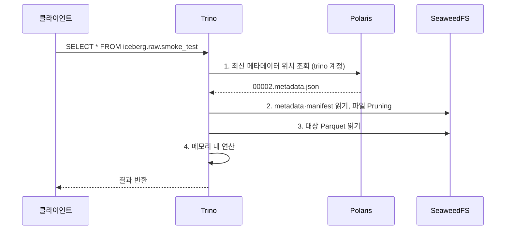
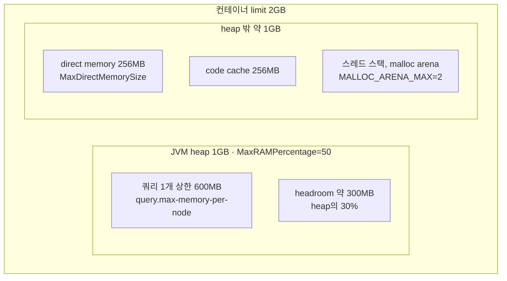
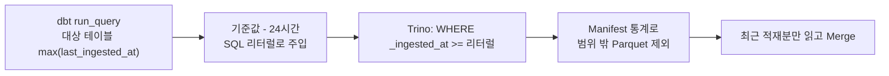

#### 개요

데이터 레이크하우스 구조에서 객체 스토리지(SeaweedFS)는 물리 파일을 보관하고 REST Catalog(Polaris)는 메타데이터 포인터 위치를 관리한다. 그러나 두 컴포넌트 모두 표준 SQL 쿼리를 받아 대규모 연산 파이프라인을 실행하는 기능은 없다.

Trino는 **"자체 스토리지 없이 Polaris 카탈로그와 연동하여 SeaweedFS 상의 Parquet 및 Avro 데이터를 분산 계산하는 전용 SQL 쿼리 엔진"**이다. 본 문서에서는 Trino의 쿼리 실행 메커니즘과 로컬 리소스 제약 환경에서의 JVM 메모리 튜닝 과정을 정리한다.

---

#### 1. Trino의 SQL 실행 처리 파이프라인



Trino는 완전한 비저장형(Stateless) 엔진이므로, 컨테이너를 정지하거나 삭제 후 재생성하더라도 하부 Iceberg 테이블 데이터와 메타데이터에는 전혀 영향을 주지 않는다.

---

#### 2. 다중 레이어 엔티티 네이밍 매핑 구조

데이터 플랫폼의 각 컴포넌트 간 식별자 네이밍 체계가 상이하므로 아래와 같은 매핑 관계를 명확히 이해해야 한다.

| 식별 레이어 | Trino 표현식 | Polaris 표현식 | 스토리지 물리 위치 |
| :--- | :--- | :--- | :--- |
| **Top-level Container** | Catalog (`iceberg`) | Catalog (`lakehouse`) | SeaweedFS Bucket (`lake`) |
| **Group / Namespace** | Schema (`raw`) | Namespace (`raw`) | Storage Folder (`raw/`) |
| **Table Entity** | Table (`smoke_test`) | Table (`smoke_test`) | UUID Directory (`smoke_test-8e7e.../`) |

- Trino SQL문에서는 `iceberg.raw.smoke_test` 형식으로 테이블에 접근한다.

---

#### 3. 코디네이터 커넥터 및 JVM 메모리 설정

##### 커넥터 설정 (`catalog/iceberg.properties`)
```properties
connector.name=iceberg
iceberg.catalog.type=rest
iceberg.rest-catalog.uri=http://polaris:8181/api/catalog
iceberg.rest-catalog.warehouse=${ENV:POLARIS_CATALOG}
iceberg.rest-catalog.security=OAUTH2
iceberg.rest-catalog.oauth2.credential=${ENV:POLARIS_TRINO_CLIENT_ID}:${ENV:POLARIS_TRINO_CLIENT_SECRET}
iceberg.rest-catalog.oauth2.scope=PRINCIPAL_ROLE:ALL
iceberg.rest-catalog.vended-credentials-enabled=false

fs.s3.enabled=true
s3.endpoint=http://seaweedfs:8333
s3.path-style-access=true
s3.aws-access-key=${ENV:S3_ACCESS_KEY}
s3.aws-secret-key=${ENV:S3_SECRET_KEY}
```

##### JVM Heap 메모리 튜닝 (`jvm.config`)
- **Trino 기본 힙 비율**: 컨테이너 메모리 제한의 `80%`
- **초기 조정값**: 컨테이너 메모리 제한의 `60%` (2GB 제한 기준 약 `1.2GB` 힙 배정)
- **현재 설정값**: **`50%`** (약 `1GB`, 상세 변경 경과는 5절 참조)

> **JVM Off-Heap OOM 주의점**: 자바 프로세스는 GC 대상인 Heap 영역 외에도 Code Cache, Thread Stack, Direct Byte Buffer 등 Off-Heap 영역에서 추가 메모리를 소비한다. 힙 비율을 80% 이상으로 유지하면 Docker cgroup 메모리 상한을 초과하여 OOMKilled 시그널로 컨테이너가 강제 종료될 수 있다.

---

#### 4. Iceberg 메타데이터 기반 쿼리 푸시다운(Pushdown) 및 시스템 테이블

SQL 쿼리 실행 시 Trino는 Iceberg 매니페스트 파일 내 기록된 컬럼별 최솟값/최댓값(Min-Max Statistics) 통계를 먼저 파싱한다. 조건절(`WHERE`) 범위에 해당하지 않는 Parquet 데이터 파일은 **스토리지에서 읽기조차 수행하지 않는 푸시다운 스캔 최적화**를 적용한다.

```sql
-- Iceberg 특화 시스템 메타데이터 테이블 쿼리 (스냅샷 이력 조회)
SELECT snapshot_id, committed_at, operation, summary['added-records']
FROM iceberg.raw."smoke_test$snapshots";
```

---

#### 5. 메모리 튜닝 경과 및 현재 기준 구성

dbt 실버 및 골드 레이어 모델이 Trino에서 실행되면서 메모리 사용량이 증가함에 따라, 총 세 차례에 걸쳐 메모리 설정을 조정했다.



| 날짜 | 발생 증상 | 조치 사항 | 설정 파일 |
| :--- | :--- | :--- | :--- |
| 2026-10-13 | 기본 80% 설정 시 Off-Heap 메모리 여유 부족 | Heap 비율 60%로 하향 조정 | `infra/trino/jvm.config` |
| 2026-10-20 | Off-Heap 메모리 점유율 증가로 컨테이너 Limit 도달 | Heap 비율 50%로 추가 하향 | `infra/trino/jvm.config` |
| 2026-11-10 | `EXCEEDED_LOCAL_MEMORY_LIMIT`: 고도몰 원본 81만 행 × 200컬럼 테이블 생성 시 단일 쿼리 상한(기본 307MB) 초과 | 단일 쿼리 메모리 상한 600MB로 상향 | `infra/trino/config.properties` |
| 2026-11-10 | 넓은 테이블 쓰기 작업 중 컨테이너 OOM Kill 2회 발생 (Exit 137) | Direct Memory 256MB 상한 지정 및 `MALLOC_ARENA_MAX=2` 적용 | `jvm.config`, `docker-compose.yml` |

- **Direct Memory 상한 설정의 효과**: 메모리 한계 초과 시 컨테이너 전체가 OOM Kill로 중단되는 대신 해당 쿼리만 실패하도록 격리한다.
- **쿼리 구조 개선 우선 원칙**: 메모리 상한 초과 시 1차 대응은 설정 상향이 아닌 쿼리 구조 최적화다. 200여 개 컬럼 전체에 `row_number()` 윈도우 함수를 적용하는 대신, 조인 키와 정렬 컬럼만 먼저 집계한 뒤 원본 테이블에 조인하는 방식으로 메모리 점유율을 낮췄다.
- **CLI 실행 위치 분리**: Trino CLI 역시 JVM 기반이므로 컨테이너 내부에서 실행하지 않고 외부에서 호출하여 불필요한 Off-Heap 메모리 소비를 방지한다.

##### 증분 모델과 파일 Pruning 최적화

4절의 Min-Max 통계 기반 Pruning은 조건값이 리터럴(Literal)일 때만 쿼리 계획(Planning) 단계에서 적용된다. dbt 증분 모델에서는 이 특성을 활용해 매 실행 시 스캔 범위를 최소화한다.



- 서브쿼리(`WHERE _ingested_at >= (SELECT max(...) ...)`) 형태로 작성하면 계획 단계에서 값을 확정할 수 없어 전체 파일을 스캔하게 된다.

---

#### 회고 및 시사점

Trino와 같은 비저장형 분산 쿼리 엔진은 컴퓨팅과 스토리지를 완벽히 분리(Decoupling)하여 유연한 확장성을 제공한다. 제한된 로컬 환경에서 안정적으로 운영하려면 JVM의 Heap과 Off-Heap 영역 간의 균형을 맞추는 튜닝과 더불어, Iceberg의 통계 기반 Pruning이 동작할 수 있도록 SQL 쿼리 패턴을 설계하는 것이 중요하다.