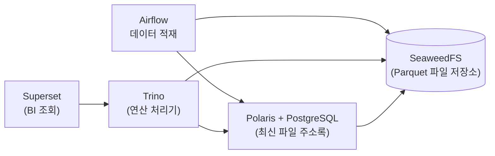
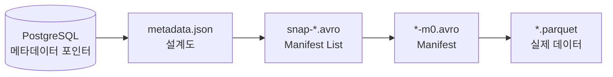
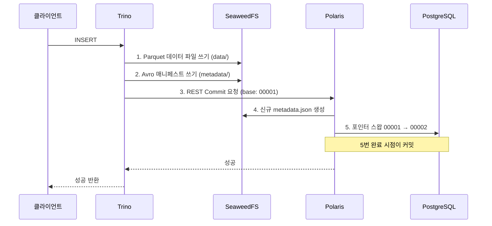
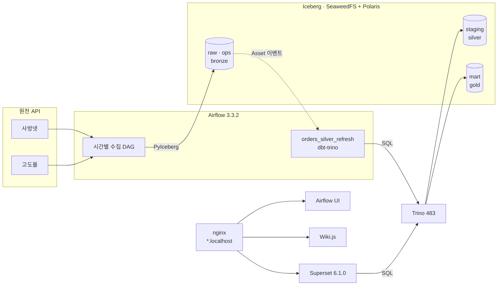

#### 개요

본 문서에서는 데이터 레이크하우스의 핵심 컴포넌트인 **SeaweedFS(객체 스토리지)**, **Polaris(REST Catalog)**, **Trino(분산 쿼리 엔진)**가 맞물려 하나의 Apache Iceberg 테이블로 작동하는 엔드투엔드(End-to-End) 메커니즘과 장애 복구 시나리오를 정리한다.

---

#### 1. 핵심 컴포넌트 역할 비교

| 구분 | SeaweedFS | Polaris REST Catalog | Trino Query Engine |
| :--- | :--- | :--- | :--- |
| **핵심 역할** | 분산 물리 파일 저장소 | 메타데이터 최신 포인터 관리 및 ACID 커밋 제어 | 비저장형(Stateless) 분산 SQL 연산 엔진 |
| **보유 데이터** | Parquet, Avro, Metadata JSON 파일 전체 | 최신 메타데이터 포인터 위치 (`PostgreSQL` 저장) | **없음 (Stateless)** |
| **통신 프로토콜** | S3 API (HTTP) | Iceberg REST Spec (HTTP) | REST / SQL over HTTP |
| **컨테이너 주소** | `seaweedfs:8333` | `polaris:8181` | `trino:8080` |
| **유실 시 영향** | **물리 데이터 영구 손실** | PostgreSQL 내 포인터 재등록을 통해 복구 가능 | 컨테이너 재시작으로 즉시 복구 |

##### 컴포넌트 간 상호작용 구조

- **SeaweedFS (실제 데이터 파일 저장소)**: 쿼리 결과로 만들어진 실제 `.parquet` 파일들이 물리적으로 쌓이는 디스크 공간.
- **Polaris + PostgreSQL (최신 상태 포인터 / 주소 장부)**: Git의 포인터처럼 "현재 이 테이블의 최신 상태를 구성하는 메타데이터 파일은 이것이다"라고 가리키는 주소 관리 레이어.
- **Trino (연산 처리 엔진)**: 주소 장부(Polaris)를 먼저 확인해 최신 파일 위치를 파악한 뒤, 저장소(SeaweedFS)에서 해당 파일들만 병렬로 읽어와 SQL 연산을 수행하는 순수 계산기.
- **Superset / Airflow (상위 인터페이스)**: 연산 엔진(Trino)으로 쿼리를 던져 시각화를 수행하거나(Superset), 저장소에 원본 데이터를 적재하는(Airflow) 실무 주체.



---

#### 2. Apache Iceberg 테이블의 계층적 메타데이터 구조

`iceberg.raw.smoke_test` 테이블을 구성하는 메타데이터 포인터의 실제 추적 흐름은 다음과 같다.

```text
PostgreSQL (polaris DB)                  SeaweedFS (s3://lake/raw/smoke_test-8e7e.../)
┌───────────────────────────────┐       ├── metadata/
│ smoke_test → 00002-....json   │──────→│   ├── 00000-....metadata.json   (Schema Init)
└───────────────────────────────┘       │   ├── 00001-....metadata.json   (Snapshot 1)
      ↑ Polaris가 포인터 관리             │   ├── 00002-....metadata.json   (Snapshot 2 - Current)
                                         │   ├── snap-....avro             (Manifest List)
                                         │   └── ....-m0.avro              (Manifest File)
                                         └── data/
                                             ├── ....parquet               (Data Parquet 1)
                                             └── ....parquet               (Data Parquet 2)
```



---

#### 3. 트랜잭션 수행 흐름 (Atomic Commit Cycle)

##### `INSERT` 수행 시 분산 컴포넌트 간 협력 메커니즘



- **All-or-Nothing 트랜잭션 보장**: 1, 2단계 중 연산 오류가 발생하더라도 5단계의 DB 포인터 스왑이 수행되지 않으므로 외부 쿼리 엔진에는 비정상적인 중간 데이터가 노출되지 않는다.
- **낙관적 동시성 제어(OCC)**: 동일 테이블에 동시 쓰기가 발생할 경우 Polaris는 Base 메타데이터 버전을 비교하여 충돌 시 커밋을 거부하고 재시도를 유도한다.

---

#### 4. 장애 및 볼륨 유실 영향 평가 시나리오

| 장애 및 유실 대상 | 물리 데이터 영향 | 테이블 조회 가능 여부 | 복구 및 대처 방안 |
| :--- | :--- | :--- | :--- |
| **Trino 컨테이너 유실** | 영향 없음 | 정지 기간 중 불가 | 컨테이너 재시작으로 즉시 복구 |
| **Polaris 컨테이너 유실** | 영향 없음 | 정지 기간 중 불가 | 컨테이너 재시작으로 즉시 복구 |
| **PostgreSQL 볼륨 유실** | 영향 없음 | **불가 (포인터 유실)** | 스토리지 내 최신 `metadata.json` 탐색 후 Polaris 재등록 |
| **SeaweedFS 볼륨 유실** | **데이터 영구 유실** | **불가 (물리 파일 손실)** | 별도 백업본이 없는 경우 복구 불가 |

---

#### 5. 데이터 플랫폼 운영 3대 핵심 원칙

1. **상태(State)와 실행 환경의 분리**: 모든 환경 변수와 자격 증명은 `.env`를 단일 진실 공급원(SSOT)으로 관리하며 컨테이너 기동 시 멱등성을 보장한다.
2. **보안 비밀값의 성격별 격리**: 일반 인증 패스워드와 데이터 암호화용 마스터 키(Fernet Key, Secret Key)를 명확히 구분해 키 변경으로 인한 기존 데이터 복호화 불능 사태를 방지한다.
3. **컴포넌트별 네이밍 체계 구분**: 쿼리 엔진(Trino), 카탈로그(Polaris), 객체 스토리지(SeaweedFS) 간의 식별자 매핑 관계를 명확히 정의해 연동 오류를 사전에 차단한다.

---

#### 6. 1단계 이후 확장된 전체 아키텍처

초기 구축한 저장·카탈로그·쿼리 엔진 3요소 위에 수집(Airflow), 변환(dbt), 시각화(Superset), 리버스 프록시(Nginx), 문서화(Wiki.js)가 결합된 전체 파이프라인 구성은 다음과 같다.



| 레이어 | 네임스페이스 | 적재 주체 | 대표 객체 |
| :--- | :--- | :--- | :--- |
| **Bronze** | `raw`, `ops` | Airflow (PyIceberg) | `raw.sabangnet_orders`, `raw.godomall_orders`, `ops.ingestion_ledger` |
| **Silver** | `staging` | dbt (Trino) | `stg_<채널>__order_lines` (Incremental), `int_order_lines`, `int_orders` (View) |
| **Gold** | `mart` | dbt (Trino) | 차원 `dim_*` (5개), 사실 `fct_*` (2개), 집계 `agg_*` (4개) |

- **실행 경로 분리**: Airflow와 Trino는 직접 데이터를 주고받지 않으며, Airflow 컨테이너 내의 dbt가 Trino로 변환 SQL을 전달해 연산을 수행한다.
- **카탈로그 일원화**: 모든 컴퓨팅 엔진이 동일한 Polaris REST Catalog를 참조하므로, PyIceberg 적재 커밋 직후 Trino와 dbt에서 최신 스냅샷을 즉시 조회할 수 있다.